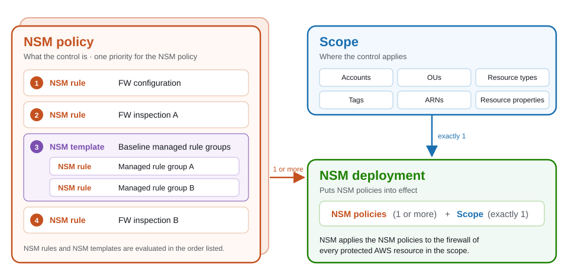

<!--
AUTHORING NOTES (applies to every NSM page)
- Always qualify "rule" as "WAF rule" or "NSM rule". Never use "rule" on its own.
- Avoid the word "policy" unless it refers to an NSM policy, and then write "NSM policy". Qualify other policies, such as "Firewall Manager policy".
- Each firewall type's "Recommended Design" page uses the same table columns (Priority, Importance, NSM policy, Scopes, Business need, NSM rules), Importance values, write-up fields (Contains, Why it's its own NSM policy, Scope, Most common owner), and scopes from the shared Common scopes list.
- Copy this entire comment block to the top of any new NSM page.
-->

# Prerequisites and Fundamentals

## Overview

You build network security controls in NSM from five resources, which are NSM rules, NSM templates, NSM policies, NSM scopes, and NSM deployments. Best practices for each resource are in the [Rules](../../rules/docs/index.md), [Templates](../../templates/docs/index.md), [Policies](../../policies/docs/index.md), [Scopes](../../scopes/docs/index.md), and [Deployments](../../deployments/docs/index.md) sections. For how each resource works, see the <!-- TODO: link --> NSM documentation.

## NSM Resources

Every network security control has two parts, what the control is and where it applies. Each NSM resource captures one piece:

* **[Rules](../../rules/docs/index.md)** – What the control is, such as a managed rule group or a logging configuration.
* **[Templates](../../templates/docs/index.md)** (optional) – A reusable, ordered set of NSM rules that you use in more than one NSM policy.
* **[Policies](../../policies/docs/index.md)** – How NSM rules and NSM templates combine, with one priority for the whole NSM policy.
* **[Scopes](../../scopes/docs/index.md)** – Where the control applies, selected by account, OU, resource type, tag, ARN, and resource property.
* **[Deployments](../../deployments/docs/index.md)** – What puts NSM policies into effect, by connecting them to a scope.

### Relationships between NSM resources

NSM rules go into NSM templates or directly into NSM policies. An NSM deployment connects one or two NSM policies to exactly one scope.

<!-- TODO: detailed relationships between NSM resources -->

## Versioning and Drafts

Every NSM resource supports drafts, versioned snapshots, and rollback. Each NSM resource is either **Active**, which means it's published, other NSM resources can reference it, and NSM deployments that include it enforce it, or **Draft**, which means it's saved but not enforced, and other NSM resources can't reference it. A versioned snapshot is an immutable copy of an Active resource that you create when you choose to. Publishing a change doesn't create one. The following best practices apply to every NSM resource.

### How changes go live

How you stage a change, and how you make it live, depends on whether an Active version of the resource already exists:

| Current state | To stage a change | To make the change live |
|---|---|---|
| New resource | Save it as a draft, which isn't enforced and can't be referenced | Create it as Active |
| Draft, with no Active version | Save the draft, which keeps it a draft | Publish the draft, which makes it the Active version |
| Active | Create a draft from it, and the Active version stays live | Edit and save it, which updates the Active version in place, and the change reaches every NSM resource that references its latest version |
| Draft on top of an Active version | Save the draft, and the Active version underneath stays live | Publish the draft, which makes it the Active version, and the change reaches every NSM resource that references its latest version |

In the API, setting `isPublished` to `false` saves a draft, and setting it to `true` makes the change live. `isPublished` is required on every update call, so an update to an Active resource that you don't save as a draft goes live right away. When you create a resource, `isPublished` defaults to `true`, so a create call creates an Active resource unless you ask for a draft.

### Versions

**Use versioned snapshots to promote changes**

To create a versioned snapshot, select an Active resource, choose **Actions**, and then choose **Create versioned snapshot**, or call the `Create{Resource}Snapshot` API operation. Snapshots are immutable, and each resource can have up to 10.

When you associate one NSM resource with another, such as an NSM rule with an NSM policy, you choose which version to reference:

* **Latest version** – Every change that goes live on the referenced resource reaches everywhere that it's deployed, with no separate promotion step.
* **Versioned snapshot** – The association stays on that snapshot, so changes that go live on the referenced resource don't reach it until you update the association to a newer snapshot.

We recommend that production reference versioned snapshots, so that you can test a change in non-production and then promote the same snapshot to production by changing only the version reference. If a change causes problems, roll back by pointing the reference at the previous snapshot, or restore the live resource by updating it with that snapshot's configuration. For a worked example, see [Use NSM rule versions to test changes before production](../../rules/docs/index.md#use-nsm-rule-versions-to-test-changes-before-production).

If you manage NSM with infrastructure as code (IaC), you might rely on source control instead of NSM versions for change history and rollback, and roll back by reverting a commit and redeploying. You can still use NSM versions to promote a change. For example, your IaC can create a versioned snapshot of an NSM policy, point a development NSM deployment at it, and then point the production NSM deployment at the same snapshot after testing. Both approaches are valid, and you can combine them. For more information, see [Console and IaC users](#console-and-iac-users).

**Reference the latest version only where changes need to take effect without a promotion step**

Referencing the latest version makes sense where you want every change to take effect without a separate promotion step, such as development or test environments that track the newest configuration of an NSM rule. Avoid referencing the latest version from production NSM policies and NSM deployments, because every change that goes live on the referenced resource then reaches production without testing.

### Drafts

Drafts are primarily for teams that manage NSM in the console. IaC users usually stage and review changes in source control and deployment pipelines instead.

**Use drafts to stage and review changes**

To change an Active resource, create a draft from it first. A draft lets you build a complete change, such as several NSM rule updates that belong together, and review it while the Active version underneath stays live. Saving a draft never changes what NSM enforces.

A change goes live when you save an edit to an Active resource or publish a draft, and every NSM resource that references its latest version picks up the change. Before you do either, check which NSM resources reference the latest version of the resource that you're changing.

<!-- TODO: confirm draft behavior, such as whether drafts can be shared or reviewed by another operator -->

### Console and IaC users

Teams that manage firewalls with IaC usually get change history, review, and rollback from source control and their deployment pipelines. Teams that manage firewalls in the console usually don't. NSM versioning gives console users the same capabilities inside NSM. Versioned snapshots keep the configurations that you choose to preserve, drafts let you stage a change before it goes live, and you can promote or roll back by changing a version reference instead of re-creating a configuration by hand.

<!-- TODO: how IaC users should combine NSM versions with source control -->
